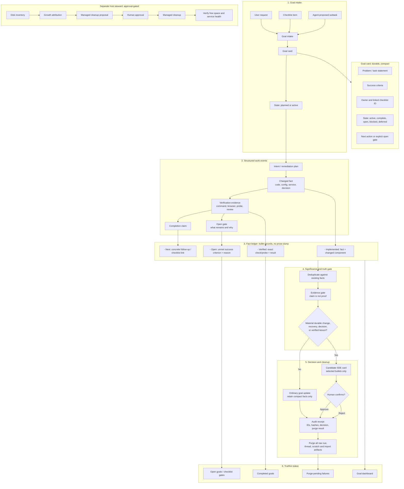

# Curator V2: goal-ledger intelligence, not transcript curation

## Summary

The missing primary object is a **goal**, created from a user request, a checklist item, or an explicit agent subtask. V2 continuously records compact, evidence-backed lifecycle facts against that goal. A real SDE is a derived durable outcome—not the unit of capture.



## Core behavior

- At task start, V2 records: **problem**, **success criteria**, linked checklist item, and initial state.
- During work, agents emit compact typed facts rather than preserving full chats: intent, change, verification, open gate, completion, and cleanup.
- At task finish, V2 records one of:
  - **Completed:** every success criterion has direct evidence.
  - **Open/deferred:** completed facts, remaining criteria, blocker, and next action.
  - **Blocked:** exact failed dependency plus recovery path.
- A significance gate derives an SDE only when evidence supports a durable implementation, decision, recovery, or lesson. Routine progress remains a goal update.
- Every durable record is short bullets, separating observed facts from planned or unverified claims.
- After approval or rejection, V2 retains the compact goal facts and an audit receipt, then removes all transient artifacts. Failed deletion is visible as `purge_pending`, never hidden behind green health.

## Token and disk discipline

- No raw transcript store, cue queue, scratch archive, or paragraph synthesis pipeline.
- One bounded goal card plus deduplicated fact bullets; new events merge into the existing goal rather than creating duplicate records.
- Evidence references carry hashes, path/command identifiers, and outcomes—not command output or chat history.
- Status reports show: active goals, completed goals, explicit open gates, SDE candidates, and failed purges.
- The separate Host Steward reports disk growth and proposes managed cleanup; it performs no deletion without approval.

## Interfaces and tests

- `goal.start`, `goal.fact`, `goal.finish`, `goal.defer`, `goal.status`
- `sde.assess`, `sde.confirm`, `artifact.purge_status`
- `steward.inventory`, `steward.propose_cleanup`, `steward.execute_cleanup`

Tests must prove that:
- a checklist task preserves its original success criteria through completion;
- an incomplete task stays open with a concrete next action;
- unsupported agent claims cannot close a goal;
- ordinary updates do not become SDEs;
- confirmed/rejected SDEs purge transient artifacts while preserving bullet facts and receipts;
- an interrupted purge is retried and visibly reported;
- no host cleanup happens without explicit approval.

## Cutover

Freeze V1 read-only, preserve existing canonical Markdown, inventory its runtime artifacts, create purge receipts, then remove obsolete V1 sources in an auditable pass. Do not import V1’s raw transcripts into V2.

## Delivery checklist

This checklist is the implementation source of truth. Every item starts **open**. A checked box means the stated evidence exists; it does not mean a component is merely designed, healthy, or present. Keep implementation status separate from runtime health.

### Per-goal and per-checklist-item record

Create one goal from the user's request, an existing checklist item, or an explicitly proposed subtask. Do not silently convert an agent inference into user intent. Keep the source checklist ID and parent goal link so the user can return to the task list.

```text
- Goal ID / checklist ID / parent goal:
- Problem or task, in one sentence:
- Success looks like:
  - [ ] Observable criterion, with its verification method
- Initial state: planned | active
- Verified facts:
  - [ ] Compact factual bullet + evidence reference + result
- Open criteria / blocker:
  - [ ] Exact unmet criterion, why it remains open, and next action
- Outcome: complete | open | blocked | deferred
- Decision / review: not-required | awaiting-human | approved | rejected
- Artifact cleanup: not-started | pending-approval | pending-persist | pending-purge | purged
- Receipt: record IDs, content hashes, decision, purge result, and timestamp
- Approval boundary: action requiring approval, approver identity, decision, and time
- Follow-up queues: todo | advise | research | formulate, each with owner and next action
- Resource budget: event/fact/evidence limits, transient footprint, and retention limit
```

Use bullets for facts, decisions, checks, open gates, and next actions; do not emit narrative paragraphs. `complete` is allowed only when every criterion has direct evidence. Otherwise leave the goal open, blocked, or deferred and retain the next action. A user rejection is a review decision, not proof that an implementation criterion passed.

### Required work-item loop: start, work, finish, and retain open truth

Apply this checklist to every request, checklist item, and accepted subtask. A
goal is the durable unit of work; a checklist checkbox is only a projection of
its verified outcome. Do not collapse the loop into a completion paragraph.

- [ ] **Start with the problem.** State the requested problem/task in one concise, neutral sentence and link its source request or checklist item. Keep inferred subtasks labeled proposed until accepted. **Success:** the original scope and source reference remain visible and cannot be silently overwritten by later events.
- [ ] **Define observable success before implementation.** List each criterion separately, with an expected proof method and whether it is required or optional. **Success:** criteria are testable, revisioned, and unchanged unless an authorized actor explicitly amends them; amendments preserve the prior version and rationale.
- [ ] **Choose an initial state and bounded plan.** Set `planned` or `active`, list the next concrete action, and record only necessary repository/service context. **Success:** the plan is actionable, scoped, and has explicit verification and rollback/recovery steps for risky changes.
- [ ] **Record events as compact typed facts.** For each meaningful event, record only the label, concise fact, goal/criterion link, evidence reference/hash, and observed result. Keep raw chat, command output, imports, scratch, and source artifacts out of the durable ledger. **Success:** facts are atomic, deduplicated, attributable, and bounded; an event can be retried without duplicating them.
- [ ] **Separate facts from proposals and claims.** Label unverified statements, agent suggestions, advice, and inferred scope as such; never present them as implemented facts or accepted user intent. **Success:** reviewers can distinguish observed, verified, proposed, and unknown without reading raw artifacts.
- [ ] **Evaluate criteria individually at finish.** Record `verified`, `unmet`, or `not evaluated`, the verifier, time, and evidence for each required criterion. **Success:** `complete` is impossible while any required criterion is unmet or unevaluated; a successful tool exit or agent claim alone cannot close the goal.
- [ ] **Select a truthful outcome.** Use `complete` only with direct evidence for all required criteria. Otherwise use `open`, `blocked`, or `deferred`, preserve the verified facts, state exactly what remains and why, and assign the next action. **Success:** incomplete work remains in the visible TODO/open-goal view and is never made to look done by an empty event queue or green service health.
- [ ] **Compile a compact bullet record.** Keep problem, criteria, implemented facts, verification, open gates, decisions, and next action as short labeled bullets. Link evidence by scoped ID/hash rather than embedding its body. **Success:** record size stays inside configured token/byte budgets and repeated events update references rather than accumulate paragraphs.
- [ ] **Classify remaining work.** Put each follow-up under `todo` (implementation), `advise` (decision/recommendation needed), `research` (fact-finding), or `formulate` (design/specification), with owner, dependency, and next action. **Success:** open work is discoverable and actionable; suggestions are not silently converted into authorized tasks.
- [ ] **Apply the approval and cleanup gate.** Before destructive cleanup, show the exact eligible artifact manifest, hashes, expected retained facts, and consequence; require attributable human approval. Persist approved compact facts and the immutable receipt before purging only listed, unchanged transient artifacts. **Success:** no approval means no deletion; failed persistence/receipt means no deletion; failed purge remains `purge_pending` with a retry path; source code, user files, canonical records, and out-of-scope paths are never eligible.
- [ ] **Close the loop with a receipt and status.** Record the decision, facts written, criterion outcomes, persistence target, cleanup outcome, and residual follow-ups. **Success:** status can be reconstructed without the raw source and clearly distinguishes `complete`, `open`, `blocked`, `deferred`, `awaiting approval`, and `purge_pending`.
- [ ] **Check resource use continuously.** Enforce per-event, per-goal, per-project, and transient-staging budgets; expose usage and the threshold that stopped ingestion. **Success:** reaching a limit is visible and non-destructive—no silent pruning of durable facts—and an explicit reviewed recovery/retention action is required to resume.

#### Work-item finish record

```text
- Problem:
- Success criteria:
  - [ ] criterion — proof method — status — evidence reference
- Outcome: complete | open | blocked | deferred
- Facts recorded:
  - Implemented:
  - Verified:
  - Open / unknown:
- Approval: not required | pending | approved | rejected — reviewer / time / rationale
- Persistence: canonical target / transaction ID / receipt ID
- Cleanup: not applicable | awaiting approval | pending persistence | pending purge | purged
- Follow-ups:
  - TODO:
  - Advise:
  - Research:
  - Formulate:
- Resource usage: event/fact/evidence/staging bytes versus configured budgets
- Next action:
```

The record is a status snapshot over append-only facts, not permission to rewrite
history. Corrections are new attributable facts linked to the prior record.
Unapproved cleanup stays open, and a task that is otherwise verified but still
has an unresolved required cleanup gate cannot be reported as fully complete.

### Implementation sequence and phase gates

Use this sequence as the delivery roadmap for sections 0–11 below. Each phase
must end with reviewable code, test output, and an explicit list of open gates;
do not advance by treating a design diagram, green process health, or a passing
unit test as end-to-end proof. All boxes remain open until their evidence is
attached. If a phase is deferred, record the reason, owner, dependency, and next
action rather than silently skipping it.

#### Phase A — repository and product contract

- [ ] Confirm repository ownership and boundaries: CuratorMD backend is separate from consumer repositories; project-specific config/plugin stays in each consumer; Host Steward remains in Hermes Core. **Exit evidence:** repo map, owner table, and architecture diagram agree; no V2 state or project config is stored in the wrong repo.
- [ ] Decide and record implementation language/runtime, supported versions, dependency policy, test/lint/type-check commands, packaging, and deployment target in a short ADR. **Exit evidence:** clean checkout can install reproducibly and run the documented checks without relying on a developer's global environment.
- [ ] Approve the V2 glossary, lifecycle state machine, trust boundaries, event/fact schemas, authorization model, and compatibility/versioning policy. **Exit evidence:** schemas and transition tables have contract tests, including invalid and future-version inputs.
- [ ] Set initial size, retention, retry, latency, and storage budgets with an owner and override process. **Exit evidence:** defaults are represented in config, surfaced in status, and covered at their boundaries.

#### Phase B — durable ledger and event correctness

- [ ] Build isolated project registration and authenticated event ingress with strict project scoping. **Exit evidence:** cross-project reads, writes, approvals, and purge requests fail closed in integration tests.
- [ ] Implement append-only goal/event/fact/criterion/evidence/decision/receipt storage, migrations, transaction boundaries, and backup/restore. **Exit evidence:** migration from empty and prior supported schema, crash recovery, backup restore, and idempotent replay pass against disposable stores.
- [ ] Implement optimistic concurrency, idempotency, duplicate detection, ordering rules, correction/supersession links, and retry semantics. **Exit evidence:** parallel-writer and replay tests show no lost facts, duplicate goals, or silent overwrite.
- [ ] Add privacy and data-minimization enforcement at ingress, logs, errors, and canonical projection. **Exit evidence:** seeded secret, personal-data, raw-chat, and oversized-payload fixtures are rejected or redacted and are absent from stores/logs.

#### Phase C — goal/checklist vertical slice

- [ ] Implement start → typed work facts → criterion evaluation → truthful finish/defer/block/reopen → bounded report for one registered fixture project. **Exit evidence:** a single automated end-to-end test proves source checklist identity, original problem/criteria, fact attribution, evidence, open TODOs, and final state survive a process restart.
- [ ] Implement repository plugin/config validation and read-only evidence/checklist adapters before enabling any writer. **Exit evidence:** malformed config, path traversal, symlink escape, stale project binding, and unauthorized write tests fail safely.
- [ ] Reconcile checklist projection only after durable goal outcome commit. **Exit evidence:** injected failure between ledger commit and checklist update is detected and recoverable without false completion or duplicate facts.
- [ ] Add dashboards/reports that distinguish service availability from useful capture. **Exit evidence:** with healthy services and zero events/goals/facts, status says capture is unproven or empty—not “healthy capture”; one known synthetic goal is traceable from ingress to report with event IDs and counts at each stage.

#### Phase D — SDE and review path

- [ ] Implement fact deduplication, evidence-quality checks, materiality decision codes, and candidate rendering from selected bullets. **Exit evidence:** paired positive/negative fixtures demonstrate why durable events qualify and routine updates, claims, and cue-only noise do not.
- [ ] Implement attributable approve/reject review and durable receipts. **Exit evidence:** a pending decision causes neither canonical promotion nor purge; approval and rejection preserve accurate goal facts and record reviewer, timestamp, and decision.
- [ ] Validate the experience with representative real development threads using redacted evidence references only. **Exit evidence:** human review confirms bullets are granular and readable, three-paragraph narrative is absent, and every assertion is traceable to a fact/evidence ID.

#### Phase E — canonical write and artifact lifecycle

- [ ] Implement the approved canonical Markdown projection with bounded size, stable identifiers, idempotent updates, and preservation of unrelated content. **Exit evidence:** repeat/recovery tests produce one record and byte-for-byte preserve non-owned sections.
- [ ] Implement exact-hash purge manifests, approval enforcement, receipt-before-delete ordering, safe executor, retry, and purge-pending reconciliation. **Exit evidence:** fault injection across every persistence/receipt/delete boundary proves no unapproved or out-of-manifest deletion and visible recovery after partial purge.
- [ ] Demonstrate artifact lifecycle from input through final disposition for both approve and reject paths. **Exit evidence:** transient artifacts are removed only after the required decision and durable fact/receipt commit; approved compact facts remain; purge failures remain visible and retryable.

#### Phase F — operations, Hermes integration, and cutover

- [ ] Add subsystem health, capture counters, freshness/lag, error categories, review backlog, open-goal age, resource use, and purge backlog. **Exit evidence:** injected failure and zero-traffic scenarios are distinguishable; alerts fire on configured thresholds without exposing content.
- [ ] Integrate with Hermes Core through scoped lifecycle events and managed MCP tools; verify Host Steward remains independent. **Exit evidence:** contract tests prove no raw-session transfer, project-bound routing, independent Steward approval, and no project-knowledge write from Steward.
- [ ] Run bounded shadow mode, V1 inventory/disposition dry run, rollback rehearsal, and one-project canary. **Exit evidence:** no consumer writes/deletions occur in shadow mode; cutover manifest is reviewed; rollback preserves canonical records and leaves V1/V2 states understandable.
- [ ] Complete release review and support handoff. **Exit evidence:** all mandatory acceptance tests pass, no unresolved critical/high security or data-loss findings remain, dashboards/runbooks are usable, and every deferred item has an owner and next action.

#### End-to-end release scenarios (mandatory)

- [ ] **No traffic:** services are available but no event arrives. Report healthy transport and zero observed capture separately; do not report successful goal/SDE processing.
- [ ] **Ordinary completed task:** one request and checklist item produce criteria, verified facts, completion evidence, a compact report, and no SDE candidate when significance is low.
- [ ] **Incomplete task:** one unmet criterion stays open with exact evidence gap and next action, including after restart and status refresh.
- [ ] **Material change:** a verified significant event produces one deduplicated candidate made only of linked bullets; an unsupported claim does not qualify.
- [ ] **Review pending/rejected/approved:** each state is visible, attributable, restart-safe, and cannot trigger an unauthorized canonical write or purge.
- [ ] **Persistence and purge failure:** injected failures leave recoverable receipts/state; no green overall status masks a pending write or purge.
- [ ] **Project isolation and Host Steward:** cross-project and self-approval attempts fail; Steward inventory/cleanup cannot write CuratorMD facts or project Markdown.

### 0. Product contract and ownership boundaries

- [ ] **Freeze the V2 vocabulary and state machine.** Define goal, checklist item, event, fact, evidence reference, SDE candidate, review decision, receipt, artifact, and purge-pending. Define allowed goal transitions and reject invalid transitions. **Success:** schema/contract tests cover every allowed and rejected transition; docs and API use the same terms.
- [ ] **Specify goal identity and deduplication.** Define stable IDs, project scope, parent/child links, checklist source IDs, idempotency keys, and duplicate-event behavior. **Success:** replaying the same event cannot create a second goal or fact.
- [ ] **Freeze ownership boundaries in code and diagrams.** Hermes Core owns profiles, runtime, event routing, MCP gateway, and Host Steward. CuratorMD Global Backend owns project registry, normalized event processing, goal/fact ledger, SDE review, persistence/purge coordination, and global operations. Each consumer repository owns its project plugin and repository-specific Curator config. The repository owns its source, task lists, and canonical project Markdown. **Success:** architecture checks and docs show only the permitted calls and writes across boundaries.
- [ ] **Keep Host Steward outside CuratorMD.** Steward may inventory host storage, attribute growth, propose policy-bounded cleanup, wait for independent human approval, execute managed cleanup, and verify space/service health. It cannot approve its own proposal, write project knowledge, or be represented as a CuratorMD component. **Success:** tests reject self-approval and project-knowledge writes; only the Hermes Core boundary contains Steward.
- [ ] **Mark V2 components as proposed until implemented.** **Success:** the system landscape and child diagrams visually distinguish proposed, implemented, and externally verified behavior without calling a green health check functional completion.

### 1. Goal intake and checklist workflow

- [ ] **Capture the initiating request before work starts.** Record a concise problem statement, user-provided success criteria, checklist reference, and planned/active state. **Success:** tests prove that later event processing does not replace or weaken the original criteria.
- [ ] **Support explicit and agent-proposed subtasks.** Preserve parent linkage and label agent proposals as proposals until accepted. **Success:** an unaccepted subtask cannot appear as user-authorized scope or close its parent.
- [ ] **Map repository checklists through the project plugin.** Resolve configured checklist sources and stable item IDs; preserve unchecked, checked, blocked, deferred, and unknown states. **Success:** fixtures cover nested items, missing IDs, malformed entries, duplicates, and stale references without silently marking items complete.
- [ ] **Expose start, status, finish, defer, and reopen operations.** Validate each transition against evidence and permissions. **Success:** transition tests include repeated requests, stale writes, missing criteria, and attempted unsupported closure.
- [ ] **Keep all unfinished tasks actionable.** Require an unmet criterion, blocker/reason, and next action for `open`, `blocked`, or `deferred`. **Success:** API rejects these states when the next action is absent, except an explicitly terminal/cancelled state if that is approved in the contract.

### 2. Event ingress, evidence, and fact ledger

- [ ] **Define the versioned project event envelope.** Include event ID, project ID, goal/checklist references, event kind, source, timestamp, schema version, idempotency key, and bounded evidence references. Exclude raw chat and artifact bodies. **Success:** schema tests reject missing scope, unknown event kinds, oversized payloads, and raw transcript fields.
- [ ] **Implement global event routing and project isolation.** Authenticate the producer, resolve the registered project/plugin, enforce project scope, and make retries idempotent. **Success:** cross-project reads/writes fail closed; duplicate delivery yields one ledger effect; retry after interruption is safe.
- [ ] **Normalize events into typed lifecycle facts.** Support intent/remediation plan, changed fact, verification, open gate, completion claim, review decision, and purge result. **Success:** every event maps deterministically or returns a visible validation error; no free-form paragraph is persisted as a fact.
- [ ] **Separate claims from evidence.** Store claim status independently from evidence quality and verification outcome; identify evidence source and hash without storing sensitive command output or raw artifacts. **Success:** completion cannot be inferred from an agent completion claim alone.
- [ ] **Deduplicate facts without erasing chronology.** Define semantic duplicate keys and preserve source/event links and corrections. **Success:** repeated identical facts compact to one visible bullet with traceable event references; conflicting facts remain distinguishable and raise a review/open gate.
- [ ] **Compile short bullet records.** Use labeled bullets such as `Problem`, `Decision`, `Implemented`, `Verified`, `Open`, and `Next`; cap record/event sizes and prevent paragraph accumulation. **Success:** snapshot tests enforce a documented size budget and reject raw transcript-like payloads.
- [ ] **Retain only bounded evidence references.** Allow source ID, hash, safe path/command identifier, and result metadata; apply path, secret, and personal-data policy before storage. **Success:** adversarial tests show secrets, credentials, personal data, command output, and raw conversation text do not reach canonical persistence or logs.

### 3. Success evaluation and truthful goal status

- [ ] **Evaluate every success criterion against direct evidence.** Support explicit verified, unmet, and not-yet-evaluated states with verifier and time. **Success:** a goal with one unmet or unevaluated required criterion cannot transition to `complete`.
- [ ] **Record outcome facts before changing checklist state.** Update the source checklist only through its configured adapter and only after the goal outcome is durably recorded. **Success:** simulated persistence failure leaves the checklist unchanged and the goal visibly retryable.
- [ ] **Represent open, blocked, deferred, and complete states consistently in API and UI.** Include next action, reason, and criterion-level facts. **Success:** contract and component tests cover each state; status never reports a goal complete merely because its event stream ended.
- [ ] **Distinguish system health from useful work.** Report ingestion health, goal counts, SDE review queue, purge-pending count, and evidence/criteria status separately. **Success:** a healthy system with zero goals/facts is explicitly distinguishable from successful task capture.
- [ ] **Add reconciliation for stuck or inconsistent state.** Detect stale active goals, mismatched checklist state, incomplete writes, and pending purges. **Success:** operator view provides exact IDs and safe retry/manual-resolution actions without silently rewriting history.

### 4. SDE assessment and human review

- [ ] **Apply fact deduplication before significance assessment.** **Success:** repeated progress cannot create repeated SDE candidates.
- [ ] **Implement evidence-quality and materiality gates.** Require durable implementation, consequential decision, verified recovery, or reusable verified lesson; exclude routine progress and cue vocabulary alone. **Success:** positive/negative fixtures cover each class and explain the decision code.
- [ ] **Build a reviewable SDE from selected fact bullets only.** Link the candidate to its goal, criteria, evidence references, and exact facts; do not generate three long narrative paragraphs or include raw artifacts. **Success:** reviewers can trace every SDE assertion to retained facts/evidence and distinguish observed from planned or unverified claims.
- [ ] **Require explicit human approve/reject for candidates.** Capture reviewer, decision, timestamp, and reason where supplied; do not infer approval from tool success or timeout. **Success:** tests prove no canonical SDE promotion or artifact purge occurs while review is pending.
- [ ] **Record rejection as a durable decision without discarding goal truth.** Keep accepted factual bullets and the review receipt according to retention policy; do not retain rejected prose as canonical knowledge. **Success:** rejection tests preserve goal facts and prevent the rejected SDE text from being presented as approved knowledge.
- [ ] **Keep learning signals separate from facts and outcomes.** Do not claim Hermes or CuratorMD learns/improves absent measured, governed feedback and an explicit model/update process. **Success:** dashboards label observations, human labels, QA outcomes, and trained model state separately; no-training state cannot be shown as learning.

### 5. Canonical persistence and purge transaction

- [ ] **Define canonical project targets in repository config.** The per-project plugin config identifies allowed Markdown persistence targets and checklist/evidence adapters; the global backend stores project registration/policy, not repo-specific paths as global write authority. **Success:** path traversal, symlink escape, unconfigured target, and cross-project target tests fail closed.
- [ ] **Implement compact, idempotent Markdown projection.** Persist only approved goal/SDE facts, criterion status, open gate/next action, and receipt references in the configured repository. **Success:** reprocessing the same decision does not duplicate sections; existing unrelated Markdown remains byte-for-byte intact.
- [ ] **Make the persistence commit the purge precondition.** Persist the approved/rejected compact facts and durable audit receipt before deleting any transient artifact. **Success:** fault injection at every write boundary proves artifacts remain if canonical persistence or receipt creation fails.
- [ ] **Create an exact purge manifest.** Identify each eligible transient artifact by scoped ID, type, size, and content hash; exclude source code, user files, canonical Markdown, and any artifact outside configured staging. **Success:** the deletion executor accepts only a validated manifest and refuses changed content or paths outside staging.
- [ ] **Purge transient captures promptly after the review/persistence gate.** Remove eligible chat/import/cue/scratch/source artifacts according to the approved retention policy; never put them into the canonical ledger. **Success:** tests verify deletion only after durable facts+receipt and the required human decision, and verify unrelated artifacts survive.
- [ ] **Make purge retryable and truthful.** Persist per-artifact result, retries, and `purge_pending` state; distinguish missing, deleted, changed, permission-denied, and retryable failures. **Success:** interrupted and partial purge tests resume idempotently and keep the system non-green until resolved or explicitly waived by policy.
- [ ] **Provide reconciliation for Markdown/ledger partial failure.** Define recovery when the ledger commits but the Markdown projection fails, or vice versa; use stable transaction IDs, hashes, and idempotent replay. **Success:** crash-injection tests at each boundary converge to one canonical record and one receipt without losing the open goal.

### 6. Per-project plugin and local repository configuration

- [ ] **Define the strict repository config schema and versioning.** Configure project identity, local scope, checklist sources, allowed read paths, evidence adapters, ephemeral staging, persistence targets, and policy bindings. **Success:** invalid/unknown keys, unsafe paths, unsupported versions, and ambiguous project IDs are rejected with actionable diagnostics.
- [ ] **Keep plugin capabilities minimal and project-scoped.** Expose configured goal/checklist/status/evidence/persistence actions; do not give the global backend ambient filesystem access. **Success:** permission tests show each adapter can access only its configured repository paths and operations.
- [ ] **Keep repository source evidence read-only by default.** Any mutating adapter must be explicitly configured, narrowly scoped, auditable, and separately authorized. **Success:** default plugin tests cannot alter source files or task files.
- [ ] **Keep local staging ephemeral and bounded.** Apply size/count/age limits, restrictive permissions, no-follow opens, cleanup receipts, and retention behavior on restart. **Success:** limit and symlink tests demonstrate bounded storage and no staging escape.
- [ ] **Validate project binding and lifecycle.** Register, suspend, rotate config, and unregister a project without confusing project state or deleting canonical repo records. **Success:** registry tests cover stale plugin bindings and safe disablement.

Progress (2026-10-19): GPTMD now contains `.curatormd-v2.toml` with a bounded
repository read scope, `curator_v2` checklist binding, ephemeral staging root,
and only `persistence/HISTORY.md` plus `persistence/LESSONS-LEARNED.md` as
canonical targets. Curator V2 loaded and bound that real config, then a
temporary stdio process exercised planned goal intake from an exact checklist
line/revision, activation, a compact change fact, and evidence-gated finish
remaining `open`. A separate read-only process exposed project status without
writing. All test databases were disposable; no canonical Markdown was written.
This does not yet install/enable the process in the Hermes profile, establish
host-authenticated profile identity, verify repository evidence, or test
canonical persistence, full artifact inventory, or cross-project runtime
isolation. The checklist items remain open.

### 7. Hermes Core integration and Host Steward

- [ ] **Integrate with Hermes Core profile and runtime lifecycle.** Send scoped lifecycle events through the global router and managed MCP gateway; do not transfer raw sessions by default. **Success:** contract tests verify event identity, retry behavior, project binding, and no raw conversation payload.
- [ ] **Define the global project registry contract.** Resolve project IDs to registered plugin/config identity and policy version. **Success:** unknown, suspended, or mismatched project binding fails closed and is visible in operations state.
- [ ] **Specify Steward as an independent, optional host service.** Define inventory sources, growth attribution, cleanup policy, proposal, independent human approval, managed executor, post-cleanup verification, and host-only receipts. **Success:** the child diagram and integration tests prove Steward never writes project knowledge and cannot approve itself.
- [ ] **Make health observable by subsystem.** Expose Core runtime, event router, gateway, global backend, plugin binding, persistence, and purge state independently. **Success:** injected failure in any subsystem shows the responsible component and does not produce an overall misleading green result.

Progress (2026-10-19): Hermes Core's Codex app-server source checkout now
emits bounded profile-scoped `codex:turn:start` and `codex:turn:end` hooks;
its focused app-server and Gateway hook tests passed 29/29 and 23/23. Curator
V2 has a local stdio launcher that pins one configured project and profile
assertion, defaults to read-only, and grants optional writes only for that
project. The launcher has not been registered in Hermes; its profile argument
is not authentication, and Codex lifecycle hooks are not yet mapped to V2 goal
events. No live gateway event, project authorization, or deployment is verified.

### 8. Operations, privacy, security, and recovery

- [ ] **Set explicit resource budgets.** Bound event bytes, facts per goal, evidence references, candidate size, staging bytes/count/age, retries, and retention. **Success:** load/boundary tests demonstrate configured limits and graceful visible rejection.
- [ ] **Set access control and audit policy.** Define project roles, user approval identity, service authentication, secret handling, audit retention, and least-privilege filesystem/database access. **Success:** authorization tests cover cross-project access, impersonation, privilege escalation, and approval attribution.
- [ ] **Define backup/restore and schema migration policy.** Cover goal ledger, receipts, project registry, and canonical projection; exclude transient artifacts unless explicitly required for an unresolved purge. **Success:** restore and upgrade tests preserve IDs, decisions, facts, and purge state without resurrecting purged raw artifacts.
- [ ] **Document operational recovery paths.** Include ingress retry, stale goal reconciliation, persistence repair, interrupted purge, plugin/config rollback, and human resolution. **Success:** each failure state has an automatic retry where safe and a concrete manual path with no destructive default.
- [ ] **Add observability without content leakage.** Metrics/logs may include IDs, counts, hashes, states, and error categories, not raw user messages, transcripts, artifacts, secrets, or patient data. **Success:** log-scrubbing tests cover normal, error, retry, and audit flows.

### 9. Migration, rollout, and release gates

- [ ] **Inventory V1 behavior and data before cutover.** Classify canonical Markdown, pending reviews, native inbox/cues, scratch/imports, runtime files, and orphan artifacts by owner, value, size, and retention. **Success:** inventory is reviewable and hash-backed; unknown or unreviewed material is not deleted.
- [ ] **Freeze V1 writes and preserve its canonical Markdown.** Define read-only mode, rollback window, and ownership for any still-open V1 work. **Success:** tests/operational procedure prove V1 cannot race V2 or alter V2 records during cutover.
- [ ] **Choose explicit V1 disposition per artifact class.** Never bulk-import raw transcripts, cues, or scratch into V2; migrate only reviewed, compact canonical facts with provenance where approved. **Success:** dry-run manifest lists every keep, migrate, archive, or purge action and requires review before execution.
- [ ] **Run V2 in shadow mode against a bounded fixture/project.** Compare observed events, goal transitions, facts, SDE candidates, and purge decisions without writing or deleting consumer data. **Success:** discrepancies are documented and resolved before any real project cutover.
- [ ] **Release behind an explicit enablement flag and rollback plan.** Start with one isolated test project; expand only after acceptance gates pass. **Success:** disabling V2 stops new processing without deleting durable records or blocking Hermes Core.
- [ ] **Publish a support and compatibility matrix.** Document supported runtime, database, plugin/config versions, Markdown conventions, and migration status. **Success:** incompatible combinations fail early with actionable errors.

### 10. Required acceptance suite

- [ ] Checklist-origin task retains its exact initial problem and success criteria through all transitions.
- [ ] Agent-proposed subtask remains labeled as a proposal until explicitly accepted and never closes its parent without evidence.
- [ ] Each success criterion is traceable to verification evidence; unsupported claims cannot complete a goal.
- [ ] Open, blocked, and deferred goals retain verified facts, exact unmet criteria, reason, and concrete next action.
- [ ] Duplicate and out-of-order events are idempotent or visibly rejected; concurrent updates do not lose facts.
- [ ] Project isolation prevents cross-project discovery, writes, approvals, or artifact deletion.
- [ ] Routine updates remain ordinary goal facts; only material, evidence-backed events become reviewable SDE candidates.
- [ ] SDE review shows compact bullet facts, source references, criterion impact, and observed-versus-unverified labels; it does not contain raw transcript or artifact content.
- [ ] Approval and rejection each produce an attributable durable receipt; pending review does not purge artifacts.
- [ ] Canonical persistence failure prevents purge; receipt failure prevents purge; partial purge is visible and retryable.
- [ ] Successful purge removes only exact eligible manifest entries and retains only approved compact facts and audit receipts.
- [ ] Markdown projection is confined, atomic, idempotent, size-bounded, and preserves unrelated content.
- [ ] Steward cannot self-approve cleanup, delete outside its managed policy, or write CuratorMD/project knowledge.
- [ ] A healthy service with zero captured goals is not reported as successful event capture; stale/open/purge-pending work prevents misleading green status.
- [ ] Logs, metrics, and error reports contain no secrets, raw chats, transcripts, or artifact bodies.
- [ ] V1 dry-run/cutover and V2 rollback procedures pass against disposable fixtures before a consumer repository is enabled.

### 11. Completion report for each checklist item

When an item is finished, replace its unchecked box only after attaching direct evidence in a concise result entry:

```text
- Status: complete | open | blocked | deferred
- Facts recorded:
  - Implemented: component and behavior
  - Verified: exact automated check/probe and result
  - Open: remaining criterion and reason, or `none`
  - Next: follow-up action, or `none`
- Persistence: target and stable record/receipt ID
- Cleanup: artifact-manifest ID, deleted count, failed count, or `not applicable`
```

Do not report a phase complete while any required item is open, evidence is missing, a purge is pending, or a rollback/recovery gate is untested. Record phase-level residual work as open checklist items rather than hiding it in a completion paragraph.
